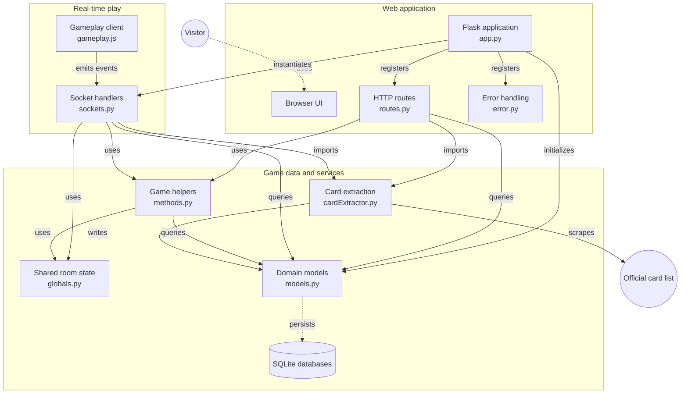

# Feat Buddyfight

An online, real-time multiplayer platform for the **Future Card Buddyfight** trading card game, built with Flask and Socket.IO. Players build decks from a catalogue of **7,400+ real cards**, open lobbies, play live matches against each other in the browser, and spectate or chat with other players while games are running.

> Built for a school project. Non-commercial and fan-made. See [Disclaimer](#disclaimer).

**Live site:** [featcrazyball.com](https://featcrazyball.com)


*A live match: both players' fields, hands and gauge update in real time, with the game log and controls on the right.*

---

## Why I built this

Buddyfight's official servers and physical play scene have mostly faded, so there's no easy way to play it online with friends. The goal was a site where you could do everything a real player does — collect cards, build a legal deck, sit down across from an opponent, and play — without needing physical cards or being in the same room.

## Features

| Area | What it does |
|---|---|
| **Live matches** | Two players join a room and play in real time. Drawing, moving cards between zones, gauge, life, buddy calls, resting/standing cards, shuffling and deck/drop-zone searches are all synced instantly over WebSockets. |
| **Spectator mode** | Anyone can watch an in-progress match live, with its own view of both fields and the phase/life updates. |
| **Arena lobby** | Create or join game rooms with a room code. The server checks that you have a deck selected, a buddy chosen, and at least 50 cards before letting you in. |
| **Game log / mini-chat** | Every action in a match generates a readable log line ("X moved Y from hand to field") so both players and spectators can follow what happened. |
| **Deck builder** | Build, edit, save and delete decks from the cards you've unlocked; pick a flag, a buddy card and starting life/hand/gauge values. |
| **Card catalogue** | Search and filter all 7,400+ cards by world, attribute, rarity and more. |
| **Card scraper** | `cardExtractor.py` crawls the official English card list and populates the database (name, stats, abilities, flavour text, artwork). |
| **Gacha & shop** | Spend tickets to pull random cards (single or 10×, filterable by world); duplicates refund tickets. A mock shop sells ticket bundles with full payment history. *No real money is involved.* |
| **Chat rooms** | Public real-time chat rooms (General, Deck, Events) plus user-created rooms. |
| **Anime pages** | Browse and watch Buddyfight episodes by season. |
| **Accounts** | Registration/login with hashed passwords, profile pictures, card sleeves, username/email/password changes, and player reports. |
| **Admin dashboard** | Manage users, reports, payments, match history, sleeves, episodes and individual cards. |
| **Discord integration** | Optional bot posts to a Discord channel when a room is created or a match is won. |
| **God Account** | A button I added after launch so friends testing the game could unlock the full card pool instantly instead of grinding the gacha. |

## Screenshots

| Arena lobby | Card database |
|---|---|
| 
 | 
 |
| **Your decks** | **Deck editor** |
| 
 | 
 |

## Tech stack

- **Backend:** Python 3.11, Flask, Flask-SocketIO (gevent), Flask-SQLAlchemy
- **Database:** SQLite, split across six databases via SQLAlchemy binds (users, cards, items, reports, episodes, matches)
- **Frontend:** Jinja2 templates, vanilla JavaScript, CSS
- **Real-time:** Socket.IO with optional Redis message queue
- **Scraping:** Requests + BeautifulSoup
- **Deployment:** Docker + Gunicorn on [Fly.io](https://fly.io) (Singapore region), with a persistent volume for the databases and automatic deploys from `main` via GitHub Actions

## Architecture



**How a match works:** game rooms live in memory (`globals.py`) for speed, keyed by a generated room code. When a player acts, `gameplay.js` emits a Socket.IO event; `sockets.py` validates it against the room state, updates the relevant zone through helpers in `methods.py`, and broadcasts the change to both players and any spectators in that room. Results are written to the matches database when the game ends.

## Project structure

```
├── app.py               # App setup, database binds, Socket.IO initialisation
├── routes.py            # All HTTP routes (pages, deck builder, gacha, admin APIs)
├── sockets.py           # Socket.IO handlers: chat, lobby, live gameplay
├── methods.py           # Shared helpers: auth decorators, deck/zone logic
├── models.py            # SQLAlchemy models (User, Card, Deck, Match, ...)
├── cardExtractor.py     # Scraper for the official card list
├── error.py             # Custom error pages for every HTTP status code
├── globals.py           # In-memory room state
├── templates/           # Jinja2 pages
├── static/              # JS, CSS, images
├── Dockerfile, fly.toml # Deployment
└── .github/workflows/   # Auto-deploy to Fly.io
```

## Running locally

```bash
git clone https://github.com/Featcrazyball/Feat-Buddyfight.git
cd Feat-Buddyfight
python -m venv venv
source venv/bin/activate        # Windows: venv\Scripts\activate
pip install -r requirements.txt
python app.py
```

Then open <http://localhost:8080>. The card database is included in `instance/`, so the catalogue works out of the box.

**Optional environment variables**

| Variable | Purpose |
|---|---|
| `PORT` | Port to run on (default `8080`) |
| `REDIS_URL` | Redis message queue for running multiple workers |
| `DISCORD_BOT_TOKEN`, `DISCORD_CHANNEL_CREATE`, `DISCORD_CHANNEL_WIN` | Discord notifications |

Or with Docker:

```bash
docker build -t buddyfight .
docker run -p 8080:8080 buddyfight
```

## What I learned

This was the first web application I ever built, so almost everything in it was new to me.

- **The fundamentals of the web.** I learned HTML, CSS and JavaScript by building real pages rather than tutorials, and how a Flask backend, templates and browser-side scripts fit together into one application.
- **Real-time communication with sockets.** Normal HTTP requests weren't enough for a live card game, since both players need to see every move the instant it happens. Learning Socket.IO meant thinking in terms of events, rooms and broadcasts, and keeping the state of a game consistent across two players and any number of spectators.

## What I'd do better

I only realised the biggest limitation of this project after I finished it and tried to host it properly: **it doesn't scale.**

- **SQLite is a local file.** All the data lives in SQLite databases on one machine's disk. That's fine for a school demo, but it means the app can only ever run on a single server. Two servers can't safely share the same database file.
- **Game rooms live in memory.** Active matches are stored in a Python dictionary inside the running process. If I added a second server, a player connected to one couldn't see a room created on the other, and restarting the app ends every game in progress. This is why the deployment is pinned to a single worker.

Fixing this properly means moving to a networked database such as PostgreSQL and keeping shared, short-lived state like game rooms in something like Redis, so any number of servers can serve the same players. Running into this problem is what got me interested in **system design and cloud architecture**, which is what I want to learn next: how real applications are structured so they can grow beyond one machine.

## Disclaimer

This is a non-commercial fan project made for learning. Future Card Buddyfight, its cards, artwork and anime belong to **Bushiroad**. Card data and images come from the official Buddyfight card list. The shop and ticket system were a course requirement and use no real money.

This is a non-commercial fan project made for learning. Future Card Buddyfight, its cards, artwork and anime belong to **Bushiroad**. Card data and images come from the official Buddyfight card list. The shop and ticket system were a course requirement and use no real money.
